# DNS Forwarder with Local Cache (UDP, Python)

[](https://github.com/Uliford/dns-cache-forwarder/actions/workflows/tests.yml)


[](LICENSE)

A small local DNS server written in Python. It receives DNS queries over UDP, answers repeated ones from an in-memory cache that respects each record's TTL, and forwards everything else to a public resolver (Cloudflare `1.1.1.1` by default). It is about 120 lines of code, uses only the standard `socket` module for networking and [dnspython](https://www.dnspython.org/) for building and parsing DNS messages.

I built it for **Project 1 of Computer Networks II** at the Hellenic Mediterranean University (HMU), Department of Electrical & Computer Engineering. It handles real traffic: with the operating system pointed at it, Firefox browsed normally through it (134 queries in 32 seconds, no errors).

## Features

- **UDP DNS server** on any port (`5300` by default, `53` with root).
- **TTL-aware cache** keyed by `(name, type)`. Entries live for the smallest TTL in the answer and are dropped when they expire.
- **Correct cached answers**: the reply carries the new query's ID and the TTL that is left, not the original one.
- **Forwarding** of the original packet to an upstream resolver, with a 2-second timeout.
- **SERVFAIL** to the client when the upstream resolver does not answer.
- **Never crashes on bad input**: malformed packets are logged and ignored.
- **Readable log** of every decision: `QUERY`, `CACHE HIT`, `CACHE MISS`, `CACHED`, `EXPIRED`, `MALFORMED`, `ERROR`.
- **End-to-end tests** against a fake upstream resolver, run by GitHub Actions on every push.

## How it works

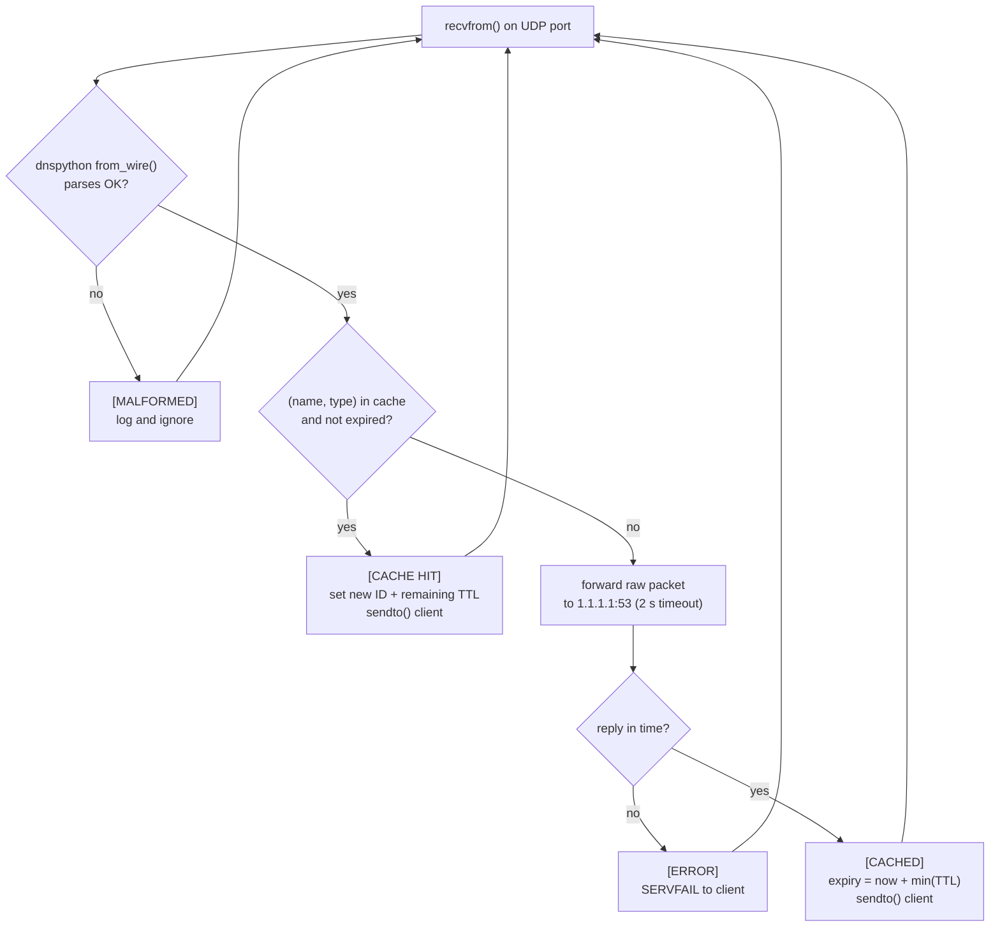

On a cache miss the server acts as a client itself. The query travels like this, with the same transaction ID on all four packets because the original datagram is forwarded unchanged:

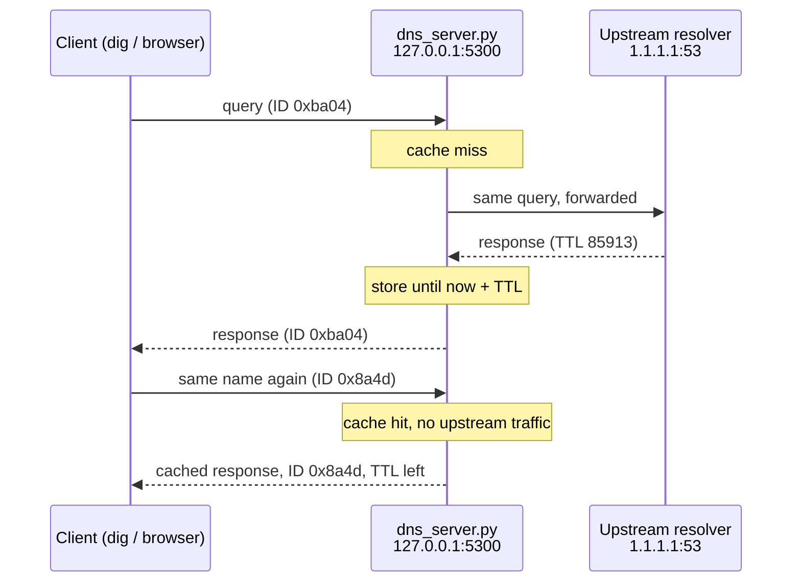

## Requirements

| What | Version | Why |
| --- | --- | --- |
| Python | 3.10 or newer | runs the server |
| [dnspython](https://pypi.org/project/dnspython/) | 2.6 or newer | builds and parses DNS messages |
| `dig` (package `dnsutils` / `bind9-dnsutils`) | any | optional, for sending test queries |
| Wireshark | any | optional, for looking at the packets |

I developed and tested it on Ubuntu 24.04 with Python 3.12 and dnspython 2.9. It also runs on macOS and Windows.

## Quick start

```bash
git clone https://github.com/Uliford/dns-cache-forwarder.git
cd dns-cache-forwarder
python3 -m venv venv
source venv/bin/activate          # Windows: venv\Scripts\activate
pip install -r requirements.txt

python dns_server.py              # listens on 127.0.0.1:5300
```

In a second terminal:

```bash
dig @127.0.0.1 -p 5300 google.com     # first time: CACHE MISS, forwarded to 1.1.1.1
dig @127.0.0.1 -p 5300 google.com     # second time: CACHE HIT, ~0 ms
```

### Options

```text
python dns_server.py [port] [--host HOST] [--upstream IP] [--upstream-port PORT] [--timeout SECONDS]

  port             UDP port to listen on (default 5300; 53 needs root)
  --host           address to bind (default 127.0.0.1)
  --upstream       upstream resolver (default 1.1.1.1)
  --upstream-port  upstream port (default 53)
  --timeout        upstream timeout in seconds (default 2)
```

Why `5300` and not `5353` or `53`: ports below 1024 need root on Linux, and `5353` is the mDNS port, which `avahi` already uses on Ubuntu.

## Running the tests

The tests start the real server as a subprocess and point it at a fake resolver on localhost, so they need no Internet access.

```bash
python -m unittest discover -s tests -v
```

| Test | Checks that |
| --- | --- |
| `test_1_miss_then_hit` | the second query (even in different letter case) is served from the cache, with the right ID |
| `test_2_expiry` | an expired entry is fetched from upstream again |
| `test_3_nxdomain_passed_through` | NXDOMAIN answers reach the client unchanged |
| `test_4_servfail_on_timeout` | a silent upstream produces SERVFAIL, not a hang |
| `test_5_survives_malformed_packets` | random bytes do not crash the server |

## Demo and results

The screenshots below come from the course demo on Ubuntu 24.04 in VirtualBox. The server log messages were in Greek in that version; the code in this repository logs in English.

### Cache miss vs. cache hit

| | First query (miss) | Same query 53 s later (hit) |
| --- | --- | --- |
| `Query time` in dig | 56 ms | 2 ms |
| TTL in the answer | 64 s | 11 s (64 − 53) |
| Packets on the wire | 4 (two of them to 1.1.1.1) | 2 (loopback only) |

<p align="center">
  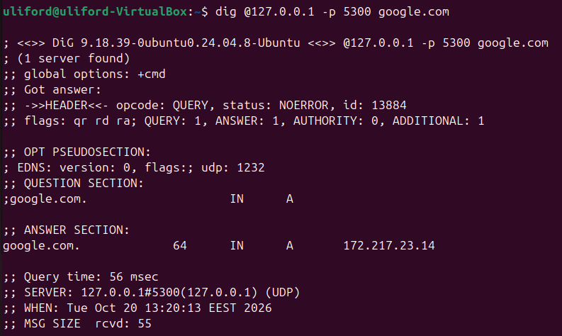
  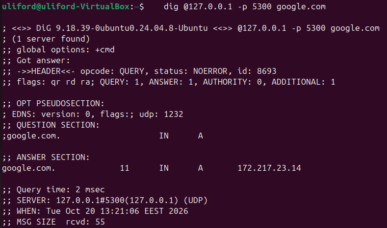
</p>

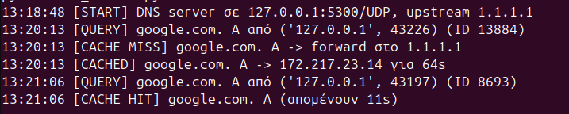

### TTL expiry

After the TTL runs out the entry is removed and fetched again. The new answer came back with a different IP and TTL: Google spreads users over many server replicas and keeps its TTLs short so it can move them quickly.

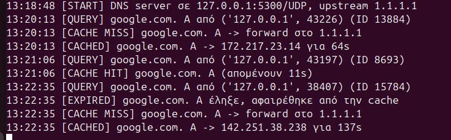

### Errors and bad input

| Scenario | Result |
| --- | --- |
| Name that does not exist | `NXDOMAIN` from the `.com` TLD servers, passed through and not cached |
| `hello` sent to the port (6 bytes) | `ShortHeader`, logged and ignored |
| 40 random bytes | `BadLabelType`, logged and ignored |
| Upstream unreachable | `SERVFAIL` after the 2 s timeout |


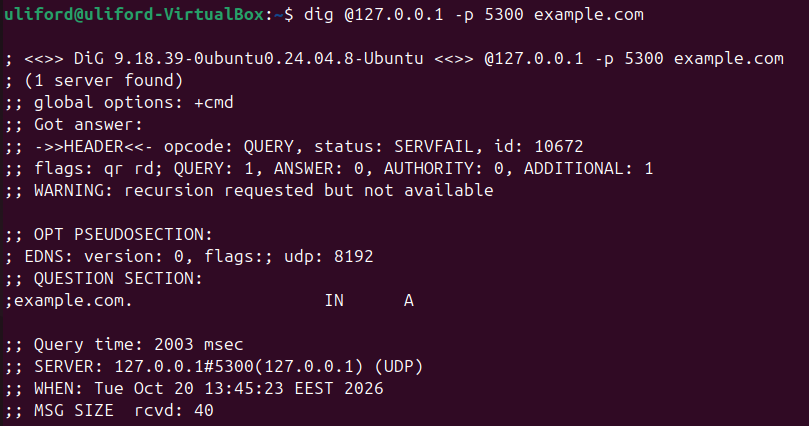

### Real browser traffic

I ran the server on port 53 and pointed Ubuntu's resolver at it, then browsed with Firefox:

```bash
sudo venv/bin/python dns_server.py 53
sudo resolvectl dns enp0s3 127.0.0.1
# ... browse ...
sudo resolvectl revert enp0s3        # always restore afterwards
```

In 32 seconds the server handled **134 queries** for 51 names (47 A, 53 AAAA, 34 HTTPS records), served 15 of them from the cache and logged no errors.

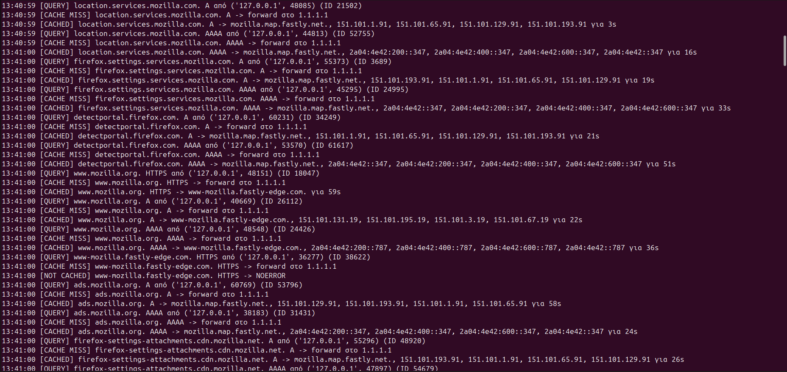

## Looking at the packets in Wireshark

1. Capture on **Loopback: lo** (Linux/macOS) or **Adapter for loopback traffic capture** (Windows).
2. Display filter: `udp.port == 5300`. To see the forwarded leg as well, capture on **any** and use `udp.port == 5300 || ip.addr == 1.1.1.1`.
3. Open **Domain Name System** in the packet details to see the header fields.

<p align="center">
  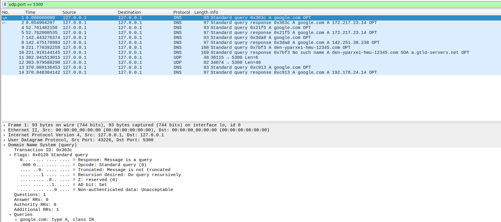
  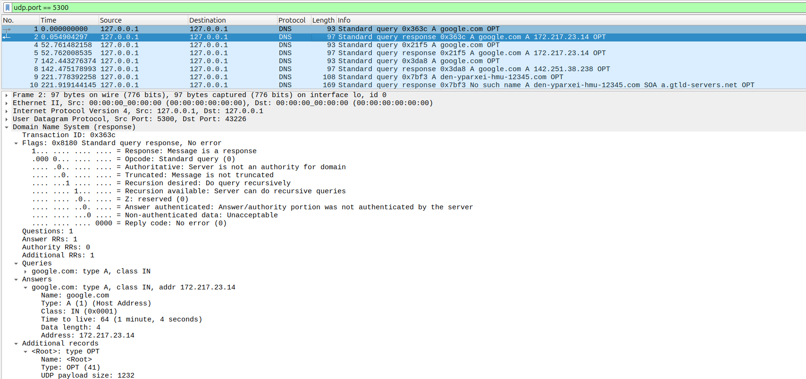
</p>

The response from the cache keeps the client's own transaction ID and shows the remaining TTL:

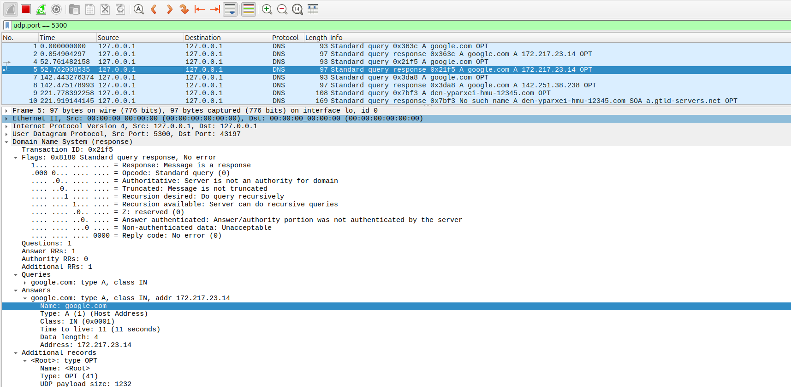

The full path of a cache miss, and the cache hit that follows it:

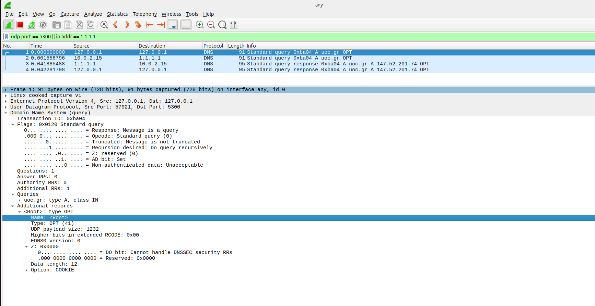
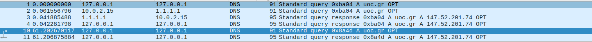

## DNS message format in one table

Queries and responses share the same layout ([RFC 1035 §4.1](https://www.rfc-editor.org/rfc/rfc1035#section-4.1)): a 12-byte header followed by four sections.

| Part | Fields | Where you see it in this project |
| --- | --- | --- |
| Header | ID, flags (QR, Opcode, AA, TC, RD, RA, Z, RCODE), 4 counters | cached answers get the new ID; RCODE 2 = SERVFAIL, 3 = NXDOMAIN |
| Question | QNAME, QTYPE, QCLASS | the cache key is (QNAME, QTYPE) |
| Answer | resource records with TTL | the TTL decides how long an entry stays cached |
| Authority | NS / SOA records | the SOA from `a.gtld-servers.net` in NXDOMAIN answers |
| Additional | e.g. the OPT record of EDNS(0) | `ARCOUNT = 1` in queries from dig |

## Project structure

```text
dns-cache-forwarder/
├── dns_server.py              # the server
├── requirements.txt           # dnspython
├── tests/
│   └── test_dns_server.py     # end-to-end tests with a fake upstream
├── docs/screenshots/          # demo screenshots (dig, server log, Wireshark)
├── .github/workflows/tests.yml
└── LICENSE
```

## Limitations and next steps

The server is deliberately simple, close to the UDP server example from the course slides. A production resolver would also need:

- **Concurrency.** It handles one query at a time; a slow upstream delays the next queries by up to 2 s. A thread per query with a lock on the cache would fix this.
- **Negative caching.** NXDOMAIN and empty answers are not cached ([RFC 2308](https://www.rfc-editor.org/rfc/rfc2308)).
- **Reply validation.** The forwarder accepts whatever arrives on its socket. Checking the source address, ID and question would make cache poisoning harder.
- **Cache size limit.** Expired entries are only removed when queried again; an LRU limit would bound memory use.
- **TCP fallback** for truncated (`TC=1`) answers.
- **RA flag on SERVFAIL** answers, so `dig` stops warning that recursion is not available.

## References

- J. F. Kurose, K. W. Ross, *Computer Networking: A Top-Down Approach*, 8th ed., chapters 2 and 3.
- [RFC 1035](https://www.rfc-editor.org/rfc/rfc1035): Domain Names, Implementation and Specification.
- [RFC 2308](https://www.rfc-editor.org/rfc/rfc2308): Negative Caching of DNS Queries.
- [RFC 6891](https://www.rfc-editor.org/rfc/rfc6891): Extension Mechanisms for DNS (EDNS(0)).
- [dnspython documentation](https://dnspython.readthedocs.io/).

## Authors

Vasilis Kostakis, Department of Electrical & Computer Engineering, Hellenic Mediterranean University, 2026.

## License

[MIT](LICENSE)
