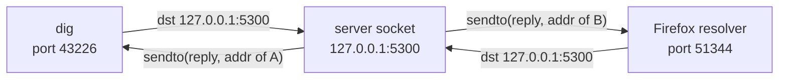
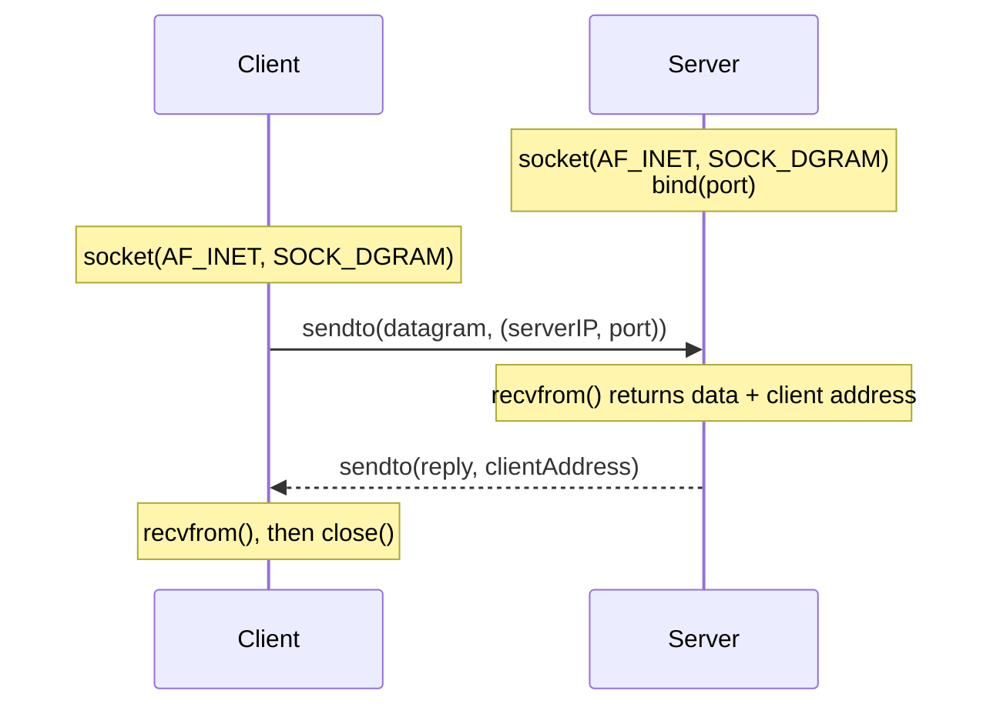
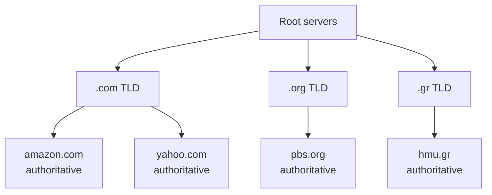
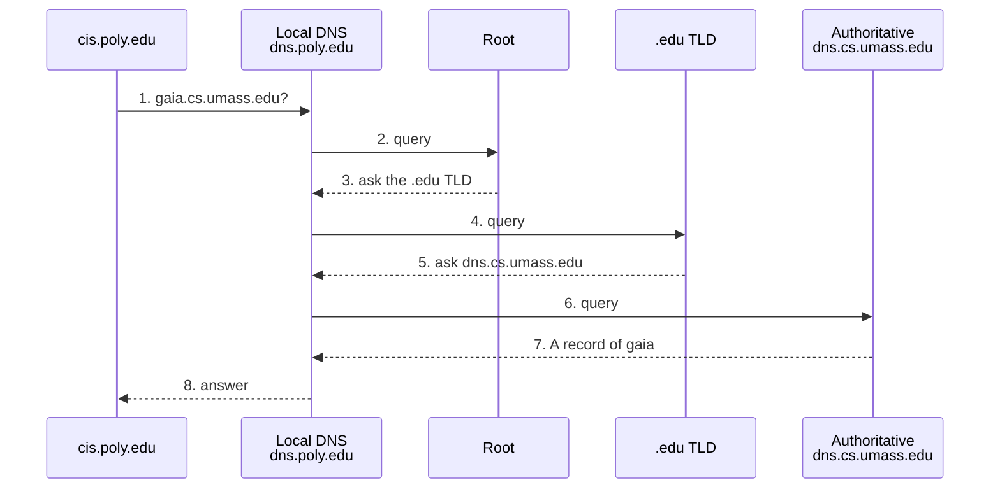
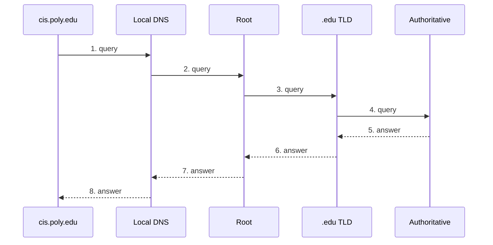
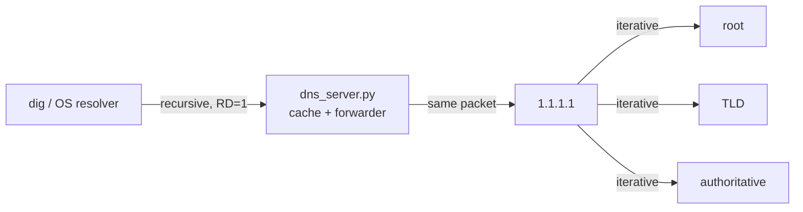

# Theory notes: UDP and DNS

These are the networking notes behind the project, written up in English from the theory part of my course report. They follow the order of the Computer Networks lectures at HMU (transport layer, then DNS) and the textbook by Kurose and Ross, and every section ends with where the idea shows up in `dns_server.py`.

Contents:

1. [Processes, sockets and the transport layer](#1-processes-sockets-and-the-transport-layer)
2. [UDP](#2-udp)
3. [The Domain Name System](#3-the-domain-name-system)
4. [How a name gets resolved](#4-how-a-name-gets-resolved)
5. [The DNS message format](#5-the-dns-message-format)
6. [A real query, byte by byte](#6-a-real-query-byte-by-byte)
7. [Message size, TCP and EDNS(0)](#7-message-size-tcp-and-edns0)

---

## 1. Processes, sockets and the transport layer

Programs on different hosts talk through **sockets**. A socket is the door between a process and the transport layer: the application developer controls everything above it, and the operating system controls everything below it. A process is addressed by two things, the **IP address** of its host and a **port number** on that host. That is why our server binds to `('127.0.0.1', 5300)` and why `dig` is told `@127.0.0.1 -p 5300`.

The Internet gives applications two transport services:

| | TCP | UDP |
| --- | --- | --- |
| Connection | three-way handshake first | none, every datagram stands alone |
| Reliability | in order, nothing lost | best effort: datagrams can be lost or reordered |
| Flow and congestion control | yes | no |
| Unit | byte stream | datagrams |
| Header | 20 bytes without options | 8 bytes |
| Python socket | `SOCK_STREAM` | `SOCK_DGRAM` |
| Typical users | HTTP, SMTP, FTP | DNS, SNMP, games, voice |

### Why DNS uses UDP

A DNS lookup is one small question and one small answer. With TCP, the handshake alone costs a full round trip before the query can even leave, which would roughly double the time of every lookup. With UDP the query goes out in the first packet. If it is lost, the client simply asks again after a timeout. DNS also keeps no per-client state, so a busy resolver does not have to hold thousands of open connections. The price is that reliability is now the application's problem, which is why our server has a 2-second timeout on the upstream and answers `SERVFAIL` when it expires.

## 2. UDP

### Connectionless demultiplexing

When a UDP datagram arrives, the host looks only at the **destination IP and destination port** to choose the socket. Datagrams from different clients, with different source addresses and ports, all land in the same socket if they target the same port. The source address is still delivered to the application, and that is the "return address" for the reply.



In code this is the pair `data, client = sock.recvfrom(4096)` and `sock.sendto(reply, client)`. One socket serves every client, which is exactly how the server works.

### The UDP header

| Field | Size | In the first query of the demo |
| --- | --- | --- |
| Source port | 16 bit | 43226, a random port picked by dig |
| Destination port | 16 bit | 5300 |
| Length | 16 bit | 59 = 8 header + 51 DNS bytes |
| Checksum | 16 bit | error detection, see below |

Eight bytes in total, compared with at least 20 for TCP.

### The checksum

The sender treats the segment as a sequence of 16-bit words, adds them in one's complement arithmetic (a carry out of the top bit is wrapped around and added back in at the bottom), and sends the complement of the sum. The receiver adds everything including the checksum; any result other than all ones means an error. The textbook example with three words:

```text
  0110011001100000
+ 0101010101010101
  ----------------
  1011101110110101
+ 1000111100001100
  ----------------
 10100101011000001   <- carry out of bit 16
  0100101011000010   <- wraparound: add the carry back in
  1011010100111101   <- checksum = one's complement of the sum
```

The checksum detects most single-bit errors but corrects nothing. A corrupted datagram is dropped, and for DNS that looks the same as a lost one: the client times out and retries.

### A UDP server in Python

The course starts from this server. It upper-cases whatever it receives:

```python
from socket import *
serverPort = 12000
serverSocket = socket(AF_INET, SOCK_DGRAM)
serverSocket.bind(('', serverPort))
while True:
    message, clientAddress = serverSocket.recvfrom(2048)
    modifiedMessage = message.decode().upper()
    serverSocket.sendto(modifiedMessage.encode(), clientAddress)
```

`dns_server.py` keeps the same skeleton. The line that upper-cases the message becomes "parse it, look in the cache, forward if needed", and the server also turns into a client itself when it asks the upstream resolver, with a second UDP socket.



## 3. The Domain Name System

DNS is two things at once: a **distributed database** spread over a hierarchy of name servers, and an **application-layer protocol** that hosts use to query it. It provides:

| Service | What it does |
| --- | --- |
| Name to address translation | `hmu.gr` to an IPv4 or IPv6 address |
| Host aliasing | a short alias points to a canonical name (CNAME) |
| Mail server aliasing | `@example.com` maps to the real mail host (MX) |
| Load distribution | one name, several addresses, rotated between replies |

### Why not one central server

A single server would be a single point of failure, would have to carry the query load of the whole Internet, would be far away from most users, and would be impossible to keep up to date. The answer is to split the database and distribute it.

### The hierarchy



- **Root servers.** There are 13 logical root servers, named `a` to `m`, run by 12 organisations. Each one is really hundreds of machines around the world that share an address through anycast. A root server does not know where `www.amazon.com` is, but it knows who runs `.com`.
- **TLD servers.** Responsible for top-level domains: generic ones like `com`, `org`, `net` and country codes like `gr`, `uk`, `fr`.
- **Authoritative servers.** Each organisation's own servers, holding the official records for its names.
- **Local DNS server (resolver).** Not strictly part of the hierarchy. Every ISP, university or company has one, and hosts send their queries to it. It works like a proxy: it answers from its cache or walks the hierarchy for the host. **This is the role our project plays**, except that instead of walking the hierarchy itself it forwards to `1.1.1.1`.

### Caching and TTL

Once any server learns a mapping, it keeps it for the record's **TTL** (time to live, in seconds) and answers later queries from memory. Because of this, TLD server addresses sit in almost every local cache and the root servers are asked rarely. The cost is that a cached entry can be out of date until its TTL runs out; DNS has no push mechanism to invalidate it (RFC 2136 adds dynamic updates, but only towards the authoritative side).

Negative answers can be cached too. When a name does not exist, the authoritative server includes its SOA record, and RFC 2308 says the "does not exist" answer may be kept for the smaller of the SOA's TTL and its `minimum` field. Our server does not do this yet; see the README.

### Putting a new name into DNS

The lecture example is a startup called Network Utopia that wants `networkutopia.com`:

1. It registers the name with a registrar and gives the names and addresses of its authoritative servers.
2. The registrar adds two records to the `.com` TLD servers:
   `(networkutopia.com, dns1.networkutopia.com, NS)` and `(dns1.networkutopia.com, 212.212.212.1, A)`.
3. The company adds an A record for `www.networkutopia.com` and an MX record for its mail on its own authoritative server.

The A record in step 2 is a **glue record**. Without it there would be a loop: to find `dns1.networkutopia.com` you would have to ask `dns1.networkutopia.com`.

### Attacks on DNS

| Attack | How it works | Relevance here |
| --- | --- | --- |
| DDoS on root servers | flood the roots with traffic | has not worked so far: anycast, filtering, and local caches mean the roots are rarely needed |
| DDoS on TLD servers | flood a TLD | more dangerous, because TLDs are queried far more often |
| Man in the middle | intercept queries and answer them | plain DNS over UDP has no encryption |
| Cache poisoning | get a fake reply accepted and cached | any caching server is a target, ours included |
| Amplification | spoof the victim's address in small queries that cause large replies | why open resolvers are a problem |

## 4. How a name gets resolved

The classic lecture example: `cis.poly.edu` wants the address of `gaia.cs.umass.edu`.

### Iterative query

Every server that is asked answers with a referral, "I don't know, ask this one". The local server does all the walking.



### Recursive query

Every server asks the next one on behalf of the previous one, and the answer comes back along the same path. This puts the load on the upper levels of the hierarchy, so in practice root and TLD servers only answer iteratively.



| | Iterative | Recursive |
| --- | --- | --- |
| Who does the work | the local server | every server on the path |
| Reply from the server asked | a referral | the final answer |
| Load on root and TLD | small | large |
| Header flags | RD = 0 towards root/TLD | RD = 1, and RA = 1 in the reply |

### Where this project sits

The project uses both kinds. The client (`dig` or the OS resolver) sends a recursive query to our server. Our server forwards it, still recursive, to `1.1.1.1`. Cloudflare's resolver then does the iterative walk through root, TLD and authoritative servers. Our server never talks to the hierarchy directly; its job is to cache what comes back so that the next identical question never leaves the machine.



### Resource records

DNS stores resource records of the form `(name, value, type, ttl)`.

| Type (code) | name | value | Seen in this project |
| --- | --- | --- | --- |
| A (1) | hostname | IPv4 address | every `dig` example |
| NS (2) | domain | authoritative server for the domain | referrals |
| CNAME (5) | alias | canonical name | answers that chain CNAME then A |
| SOA (6) | zone | serial, timers, minimum TTL | in the Authority section of NXDOMAIN replies |
| PTR (12) | reversed IP under `in-addr.arpa` | hostname | `dig -x 1.1.1.1` gives `one.one.one.one` |
| MX (15) | domain | mail server | not used |
| AAAA (28) | hostname | IPv6 address | 53 of Firefox's 134 queries |
| HTTPS (65) | hostname | connection hints such as `alpn` | 34 of Firefox's queries |

## 5. The DNS message format

Queries and responses have the same layout (RFC 1035, section 4.1): a 12-byte header and four sections.

```text
+---------------------+
|       Header        |  12 bytes: ID, flags, 4 counters
+---------------------+
|      Question       |  QNAME, QTYPE, QCLASS
+---------------------+
|       Answer        |  resource records
+---------------------+
|      Authority      |  NS records or SOA
+---------------------+
|     Additional      |  extra records: glue, EDNS OPT
+---------------------+
```

### Header

The first 16 bits are the **ID**, picked by whoever sends the query. The reply copies it, so the client can match replies to questions; with UDP there is no connection to do this. That is why our server overwrites the ID when it answers from the cache: the stored reply carries the ID of an older query.

The next 16 bits are the flags:

| Flag | Bits | Meaning |
| --- | --- | --- |
| QR | 1 | 0 = query, 1 = response |
| Opcode | 4 | 0 = standard query |
| AA | 1 | answer comes from an authoritative server |
| TC | 1 | message was truncated |
| RD | 1 | recursion desired |
| RA | 1 | recursion available |
| Z | 3 | reserved in RFC 1035; two of these bits later became AD and CD for DNSSEC |
| RCODE | 4 | result code |

| RCODE | Name | Meaning | Seen in the demo |
| --- | --- | --- | --- |
| 0 | NOERROR | success | almost every query |
| 1 | FORMERR | server could not parse the query | no |
| 2 | SERVFAIL | server-side failure | yes, when the upstream was unreachable |
| 3 | NXDOMAIN | name does not exist | yes |
| 4 | NOTIMP | query type not implemented | no |
| 5 | REFUSED | refused for policy reasons | no |

The last four header words are QDCOUNT, ANCOUNT, NSCOUNT and ARCOUNT, the number of entries in each section.

### Question

QNAME, QTYPE (A = 1) and QCLASS (IN = 1). Names are not written with dots but as a list of labels, each one prefixed by its length and the list ended by a zero byte:

```text
06 67 6f 6f 67 6c 65 03 63 6f 6d 00
   g  o  o  g  l  e     c  o  m
```

A label is at most 63 bytes and a full name at most 255.

### Resource records

| Field | Size | Contents |
| --- | --- | --- |
| NAME | variable | owner name |
| TYPE | 16 bit | A, AAAA, NS, CNAME, MX, SOA ... |
| CLASS | 16 bit | IN |
| TTL | 32 bit | seconds the record may be cached; this is what our cache reads |
| RDLENGTH | 16 bit | length of RDATA, 4 for an A record |
| RDATA | variable | the value, e.g. 4 bytes of IPv4 |

**Name compression.** In a reply the same name appears in the Question and again in the Answer. To save space RFC 1035 allows 2-byte pointers: the top two bits are `11` and the other 14 bits are an offset into the message. The common `c0 0c` means "the name that starts at byte 12", which is right after the header, where the QNAME sits. Answer records almost always begin with these two bytes.

## 6. A real query, byte by byte

These are the bytes of the first query `dig` sent to the server during the demo (packet 1 in the Wireshark capture). The frame is 93 bytes: 14 Ethernet, 20 IP, 8 UDP and 51 DNS.

**UDP header:** `a8 da 14 b4 00 3b fe 4e`

| Bytes | Field | Value |
| --- | --- | --- |
| `a8 da` | source port | 43226 |
| `14 b4` | destination port | 5300 |
| `00 3b` | length | 59 |
| `fe 4e` | checksum | |

**DNS header:** `36 3c 01 20 00 01 00 00 00 00 00 01`

| Bytes | Field | Value |
| --- | --- | --- |
| `36 3c` | ID | 0x363c, copied into the reply |
| `01 20` | flags | see below |
| `00 01` | QDCOUNT | 1 question |
| `00 00` | ANCOUNT | 0, it is a query |
| `00 00` | NSCOUNT | 0 |
| `00 01` | ARCOUNT | 1, the EDNS OPT record |

The flags in binary, next to the reply that came back from `1.1.1.1`:

```text
                  QR Opcode AA TC RD | RA Z  AD CD RCODE
query    0x0120:  0  0000   0  0  1  |  0  0  1  0  0000
response 0x8180:  1  0000   0  0  1  |  1  0  0  0  0000
```

In the query only RD (please recurse) and AD (which `dig` sets by default) are on. In the reply QR becomes 1, RA says the resolver supports recursion, RD is copied, and RCODE is 0. AA stays 0 because a resolver answered, not an authoritative server.

**Question and Additional** (39 bytes):

```text
06 67 6f 6f 67 6c 65 03 63 6f 6d 00   QNAME  = google.com
00 01                                 QTYPE  = 1 (A)
00 01                                 QCLASS = 1 (IN)
00 00 29 04 d0 00 00 00 00 00 0c ...  OPT: root name, type 41, UDP size 0x04d0 = 1232, 12-byte COOKIE
```

12 header + 12 QNAME + 4 type/class + 23 OPT = 51 bytes, which matches the UDP length.

## 7. Message size, TCP and EDNS(0)

RFC 1035 puts DNS on **UDP port 53** and limits a DNS message over UDP to **512 bytes**. If an answer does not fit, the server truncates it and sets **TC = 1**, and the client asks again over **TCP on the same port**. So DNS is not "UDP only": UDP is the normal case and TCP the fallback for big answers and for zone transfers between servers.

512 bytes is too small today, with IPv6 addresses, many records per name and DNSSEC signatures. **EDNS(0)** (RFC 6891) fixes this: the client adds an OPT pseudo-record to the Additional section that says how large a UDP reply it can accept. `dig` asks for 1232 bytes, a size that fits in one packet on almost every network without fragmentation. That is also why the server reads with `recvfrom(4096)` and not 512.

---

### References

- J. F. Kurose, K. W. Ross, *Computer Networking: A Top-Down Approach*, 8th ed., chapters 2 and 3, and the lecture slides of Computer Networks I and II at HMU based on it.
- [RFC 768](https://www.rfc-editor.org/rfc/rfc768): User Datagram Protocol.
- [RFC 1035](https://www.rfc-editor.org/rfc/rfc1035): Domain Names, Implementation and Specification.
- [RFC 2308](https://www.rfc-editor.org/rfc/rfc2308): Negative Caching of DNS Queries.
- [RFC 6891](https://www.rfc-editor.org/rfc/rfc6891): Extension Mechanisms for DNS (EDNS(0)).
